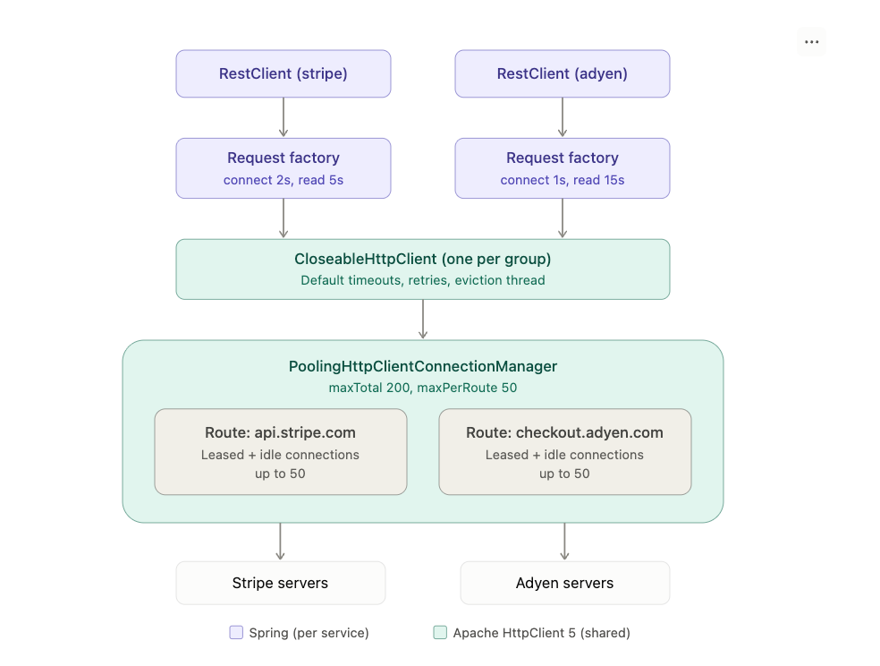

# Shared Connection Pools for RestClient with Apache HttpClient 5 (Spring Boot 3.5)

This guide explains how to share 4 connection pools across 40+ external services, while each service keeps its own connect and read timeouts.

---



## 1. Example project overview

The example project is `pooled-restclient.zip`, a complete Maven project for Spring Boot 3.5.7 with HttpClient 5.

> **Note:** The project was not compiled or tested in the workspace where it was created, because that workspace couldn't reach Maven Central. The code was checked by hand against the Spring 6.2 and HttpClient 5 APIs. Run `mvn test` first when you open it.

### How it fits together

| File | Responsibility |
|---|---|
| `application.yml` | Sets up 4 pools (`payments`, `partners`, `internal`, `slow-batch`). Each service names its pool and can set its own `connect-timeout`, `read-timeout` and `connection-request-timeout`. Any it leaves out fall back to the pool's defaults. |
| `HttpClientProperties` | Binds that configuration. |
| `HttpPoolRegistry` | Builds one `CloseableHttpClient` per pool, and the connection pool lives inside it. Also registers Micrometer metrics for each pool and closes each pool once at shutdown. |
| `RestClientFactory` | `forService("name")` gives each service its own `HttpComponentsClientHttpRequestFactory` with its own timeouts. Every factory wraps its group's shared client, so services in a group share connections but keep separate timeouts. |
| `HttpClientConfig` | Wires the beans and shows two ways to use them (see below). |
| `HttpPoolSharingTest` | Puts two services on one pool against a local server that takes 1.5 s to answer. The service with a 500 ms read timeout should fail and the one with a 3 s timeout should succeed. |

**Two ways to use it:**

- **Option A:** declare a `@Bean RestClient` per service (see `StripeClient`).
- **Option B:** call `factory.forService(...)` in each client's constructor (see `PartnerXClient`). With 40 services, Option B is less boilerplate.

**To add your other services**, add one entry for each under `http-client.services` and call `forService("their-name")`.

---

## 2. What is `CloseableHttpClient`?

`CloseableHttpClient` is the main client class in Apache HttpClient 5 (`org.apache.hc.client5.http.impl.classic.CloseableHttpClient`). It's the object that actually sends HTTP requests. It's called "closeable" because it holds resources, mainly the connection pool and background threads, that you have to release by calling `close()` when you're finished.

In this setup, the layers stack like this:

```
RestClient                                       ← Spring's fluent API (get().uri().retrieve())
  └─ HttpComponentsClientHttpRequestFactory      ← Spring adapter: turns Spring requests into Apache requests, applies timeouts
       └─ CloseableHttpClient                    ← Apache client: runs the request (retries, redirects, cookies…)
            └─ PoolingHttpClientConnectionManager ← the connection pool (open TCP/TLS connections)
```

The `CloseableHttpClient` is:

- **The owner of the pool.** You build it with `HttpClients.custom().setConnectionManager(cm)...build()`, and from then on it uses that connection manager. Two `RestClient`s share a pool only if they end up on the same `CloseableHttpClient`. That's why the example shares one client per group.
- **Where group-wide defaults live.** That includes the default `RequestConfig` (timeouts), idle and expired connection eviction (which runs a small background thread), retry and redirect behaviour, interceptors, proxy settings and so on.
- **Thread-safe and long-lived.** You create it once at startup and reuse it for the life of the application. Creating one per request would throw away the pool and open new connections every time.
- **Closeable.** `close()` (or `close(CloseMode.GRACEFUL)`) shuts down the connection manager, closes all pooled sockets and stops the eviction thread. If you skip that, connections and threads leak, which matters for tests and redeploys. In the example, `HttpPoolRegistry.destroy()` closes each client exactly once when Spring shuts down.

It's an abstract class. The instance you get from `HttpClients.custom().build()` is an internal implementation (`InternalHttpClient`), but you always program against `CloseableHttpClient`.

---

## 3. How the three classes fit together

How the classes stack for one group (the `payments` pool), with two services sharing it:

```
 ┌──────────────────────────┐            ┌──────────────────────────┐
 │   RestClient (stripe)    │            │   RestClient (adyen)     │   Spring
 └────────────┬─────────────┘            └────────────┬─────────────┘   (one per
              ▼                                       ▼                  service)
 ┌──────────────────────────┐            ┌──────────────────────────┐
 │     Request factory      │            │     Request factory      │
 │   connect 2s, read 5s    │            │   connect 1s, read 15s   │
 └────────────┬─────────────┘            └────────────┬─────────────┘
              └──────────────────┬────────────────────┘
                                 ▼
 ┌────────────────────────────────────────────────────────────────┐
 │            CloseableHttpClient (one per group)                 │   Apache
 │         Default timeouts, retries, eviction thread             │   HttpClient 5
 └───────────────────────────────┬────────────────────────────────┘   (shared)
                                 ▼
 ┌────────────────────────────────────────────────────────────────┐
 │              PoolingHttpClientConnectionManager                │
 │                 maxTotal 200, maxPerRoute 50                   │
 │                                                                │
 │   ┌───────────────────────────┐  ┌───────────────────────────┐ │
 │   │  Route: api.stripe.com    │  │ Route: checkout.adyen.com │ │
 │   │ Leased + idle connections │  │ Leased + idle connections │ │
 │   │        up to 50           │  │        up to 50           │ │
 │   └─────────────┬─────────────┘  └─────────────┬─────────────┘ │
 └─────────────────┼──────────────────────────────┼───────────────┘
                   ▼                              ▼
           ┌───────────────┐              ┌───────────────┐
           │ Stripe servers│              │ Adyen servers │
           └───────────────┘              └───────────────┘
```

Each layer does a different job.

### `HttpComponentsClientHttpRequestFactory` (Spring, one per service)

It's an adapter: `RestClient` only knows Spring's `ClientHttpRequest`, and the factory turns that into an Apache `HttpUriRequest`. It holds no connections. It mainly holds that service's timeouts and attaches them to every request it creates, so stripe's requests carry "read 5s" and adyen's carry "read 15s". That's why it's cheap to have one per service.

### `CloseableHttpClient` (Apache, one per group)

The engine. It runs each request through its pipeline: retries, redirects, cookies, interceptors, and the default timeouts used when the factory doesn't set one. It also runs the background thread that evicts idle connections. It doesn't open sockets itself; it borrows them from the connection manager. Calling `close()` on it shuts down everything below it.

### `PoolingHttpClientConnectionManager` (the pool, one inside each client)

It keeps open TCP/TLS connections, grouped by **route** (scheme + host + port):

- **Leasing:** when a request needs a connection, the manager hands out an idle one for that route. If none is idle and the limits allow, it opens a new one.
- **Waiting:** if `maxPerRoute` or `maxTotal` is reached, the request waits up to `connectionRequestTimeout` for a connection to free up.
- **Returning:** after the response is read, the connection goes back to the pool as idle so the next request can reuse it. Reuse skips the TCP and TLS handshakes, which is the whole point of pooling.
- **Cleanup:** `timeToLive`, `validateAfterInactivity` and idle eviction make sure stale or half-closed connections aren't reused.

### Lifecycle of a single call

`stripe.get().uri("/v1/balance").retrieve()` goes like this:

1. The factory builds the request with stripe's timeouts.
2. The client leases a connection to `api.stripe.com` from the manager.
3. The request goes over that connection.
4. The response comes back.
5. The connection returns to the pool, where an adyen request might reuse the same pool a moment later (on its own route).

---

## 4. Pool policies

```java
PoolingHttpClientConnectionManagerBuilder.create()
        .setPoolConcurrencyPolicy(PoolConcurrencyPolicy.STRICT)
        .setConnPoolPolicy(PoolReusePolicy.LIFO)
        // ...
        .build();
```

Both settings are already the HttpClient 5 defaults. Writing them out just makes the choice explicit in your code.

### 4.1 `PoolConcurrencyPolicy`: how strictly the limits are enforced

This picks which pool implementation the connection manager uses internally.

|  | `STRICT` (default) | `LAX` |
|---|---|---|
| Implementation | `StrictConnPool` | `LaxConnPool` |
| `maxTotal` | Enforced exactly | Not enforced; only per-route limits apply |
| `maxPerRoute` | Enforced exactly | Enforced loosely; can briefly go over under contention |
| Locking | One lock for the whole pool | Finer-grained locking per route |
| Throughput under heavy contention | Good | Somewhat better |

With `STRICT`, when a thread asks for a connection, the pool takes a lock, checks both the per-route and total counts, and either hands out a connection or makes the thread wait in a queue. That wait is bounded by `connectionRequestTimeout`. The numbers you configure are real hard limits.

`LAX` trades that precision for less lock contention. Each route manages itself, nothing caps the total, and limits can be overshot for a moment.

**For this design, keep `STRICT`.** Separate pools only protect services from each other if `maxTotal: 40` on `slow-batch` really means 40, so a hung partner can't open unlimited connections. Consider `LAX` only if profiling shows threads blocked on the pool lock at very high request rates (thousands per second on one pool), and you don't need a hard cap on total connections.

### 4.2 `PoolReusePolicy`: which idle connection to hand out next

When a route has several idle connections, this decides which one the next request gets.

#### `LIFO` (last in, first out; the default)

Hands out the connection that was returned most recently.

```
Idle stack: [c1, c2, c3, c4]  ← c4 returned last
Next request gets c4, then c4 again, and so on
c1–c3 sit unused, pass idle-eviction, and get closed
```

- The pool tends to shrink to the number of connections you actually need concurrently, so fewer sockets stay open on your side and the server's.
- The connection you get was used moments ago, so it's very unlikely the server has closed it. You'll see fewer `NoHttpResponseException` / "connection reset" errors from stale connections.

#### `FIFO` (first in, first out)

Hands out the connection that has been idle the longest, rotating through all of them.

```
Next request gets c1, then c2, c3, c4, c1…
```

- Load is spread evenly across every open connection.
- That helps when the target sits behind a layer-4 load balancer, where each TCP connection is pinned to one backend node. With `LIFO`, one or two hot connections could send most traffic to one node. `FIFO` spreads it out.
- The downside is that it keeps more connections alive and is more likely to pick one that's been idle a while. The server may have closed it after its keep-alive timeout. `validateAfterInactivity` checks such connections before reuse, which reduces this risk.

### Recommendation

`STRICT` + `LIFO` is the right default for almost every pool, including these. Switch a single pool to `FIFO` only if you notice one external service's backend nodes getting uneven load from your app. Because the policy is set per connection manager, you can do that for just that group without affecting the others.
